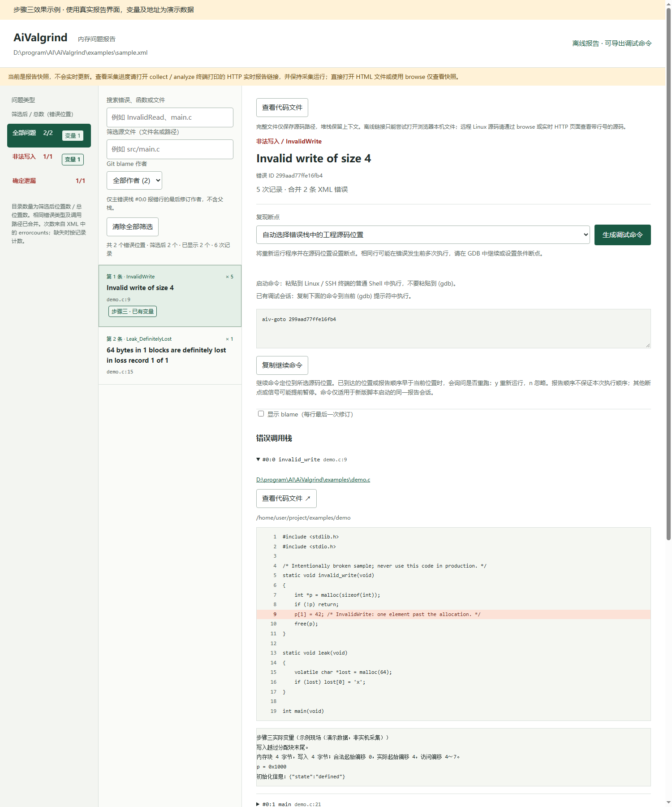

# AiValgrind

在 Linux 上联合使用 Valgrind 和 GDB，生成内存问题 HTML 报告，并在重新运行时采集错误现场变量。统一入口 `main.py`，核心功能位于 `inc/`，无需安装第三方 Python 库。

## 参数与固定文件名

路径与执行参数分别指定：

- `--progPath`：目标程序所在目录，例如 `/work/project/build`。
- `--exeName`：该目录下的可执行文件名，例如 `app`，不包含目录。
- `--exeArgs`：目标程序自己的参数，必须放在工具参数最后；程序无参数时省略。
- `--retPath`：结果目录，输入和输出都放在这里。

| 固定名称 | 用途 |
| --- | --- |
| `errors.xml` | 内存错误记录；已有 XML 请以这个名字放入结果目录 |
| `report.html` | 完整 HTML 报告，不包含新采集的变量 |
| `full-report.html` | 错误堆栈中包含变量分析的报告 |
| `run.json` | 原程序命令、工作目录、源码目录和输入记录 |
| `capture-updates.js`、`capture-progress.js` | 变量及进度数据，浏览时与 HTML 放在一起 |
| `captures/session-*` | 各次调试的原始现场 |

不用填写工程目录、工作目录、XML 或 HTML 路径。新运行默认在可执行程序所在目录执行；源码目录优先选择程序上级最近的 Git 工程，没有 Git 时使用程序所在目录。读取已有结果时，优先恢复配套 `run.json` 中属于同一程序的目录信息。仅有 XML 时可尝试从其中的绝对程序路径定位源码；找不到时仍保留错误堆栈，并说明源码不可用。源码位于另一个目录且调试信息中的路径已失效时，无法凭程序路径自动重建源码映射。

目标程序的相对参数路径按运行工作目录解释。例如程序位于 `/work/project/build/app`，`--config config.json` 默认读取 `/work/project/build/config.json`。建议给配置、输入等目标程序参数使用绝对路径。

```bash
python3.9 main.py --action analyze --mode fast --retPath /tmp/results --progPath "/work/project/build" --exeName "my app" --exeArgs --config "/work/project/configs/test case.json" --mode production --count 26
```

`--mode fast` 属于工具，`--mode production` 属于目标程序。参数逐项原样传递，含空格的参数需加 Shell 引号，不要把整条目标命令包成一个字符串。

当前 action 不需要的已知参数会警告并忽略，不中止执行；无法识别的工具参数及其附带值也会警告并忽略。仍需提供当前操作必需的参数；已知参数的值无效（例如 `--mode other`）仍会提示错误。`--exeArgs` 后的内容不按工具参数解析。

## 五种场景命令速查

以下每个场景均给出快速、完整两条完整命令，二选一执行。所有示例统一使用 `--progPath`、`--exeName`、`--exeArgs` 和 `--retPath`，不需要再填写 `--cwd`、`--project-dir`、`--xml`、`--base-report` 或 `--output`。

示例约定：程序为 `/work/project/build/app`，结果目录为 `/tmp/results`。`arg1` 是目标程序的示例参数，请替换为实际参数；没有参数就删除它。`--progPath` 和 `--exeName` 必须一起提供；`--exeArgs` 及其后的程序参数必须放在整条命令最后。场景二中的程序路径只帮助查找源码，不执行程序。

| 场景 | action 与附加开关 | 运行前需要的结果文件 | 目标程序运行次数 | 查看结果 |
| --- | --- | --- | --- | --- |
| 1. 运行程序，生成 HTML | `collect --report` | 无 | 1 次 | `/tmp/results/report.html` |
| 2. 已有 XML，生成 HTML | `report` | `errors.xml` | 0 次 | `/tmp/results/report.html` |
| 3. 运行程序，生成 HTML 并分析变量 | `analyze` | 无 | 通常 2 次 | `/tmp/results/full-report.html` |
| 4. 已有 HTML，更新变量分析 | `analyze --step3-only` | `errors.xml` 和 `report.html` | 重跑 1 次 | `/tmp/results/full-report.html` |
| 5. 已有 XML，生成 HTML 并分析变量 | `analyze --from-xml` | `errors.xml` | 重跑 1 次 | `/tmp/results/full-report.html` |

`run.json` 是可选的原运行记录；存在且属于同一程序时用于恢复原目录和输入信息。场景四不能只保留 HTML，必须同时保留同一次检测的 XML。

### 场景一：运行程序，生成 HTML

**准备：** 目标程序可运行；不需要已有 XML 或 HTML。

```bash
# 快速模式
python3.9 main.py --action collect --report --mode fast --retPath /tmp/results --progPath /work/project/build --exeName app --exeArgs arg1
# 完整模式
python3.9 main.py --action collect --report --mode full --retPath /tmp/results --progPath /work/project/build --exeName app --exeArgs arg1
```

**执行与结果：** 运行一次程序，生成 `errors.xml`、`run.json` 和完整 `report.html`，不启动 GDB，不生成新的变量分析。`--report` 不要省略，否则只保留采集摘要。运行期间也提供实时网页；中途退出后用场景二处理已保存 XML。

### 场景二：已有 XML，生成 HTML

**准备：** 把原 XML 保存为 `/tmp/results/errors.xml`，无需已有 HTML。

```bash
# 快速模式
python3.9 main.py --action report --mode fast --retPath /tmp/results --progPath /work/project/build --exeName app
# 完整模式
python3.9 main.py --action report --mode full --retPath /tmp/results --progPath /work/project/build --exeName app
```

**执行与结果：** 读取固定的 `errors.xml`，生成同目录 `report.html`，不运行程序、不需要 GDB。这里 `--progPath` 与 `--exeName` 仅帮助推导源码目录；不需要源码或已有记录能定位源码时，可以同时省略。两种模式在此场景行为相同，不会仅凭 XML 产生变量值。

### 场景三：运行程序，生成 HTML，然后更新变量分析

**准备：** 目标程序可重跑，Linux 上具备 Valgrind 和启用 Python 的 GDB。不需要已有结果文件。

```bash
# 快速模式
python3.9 main.py --action analyze --mode fast --retPath /tmp/results --progPath /work/project/build --exeName app --exeArgs arg1
# 完整模式
python3.9 main.py --action analyze --mode full --retPath /tmp/results --progPath /work/project/build --exeName app --exeArgs arg1
```

**执行与结果：** 首次检测生成 `errors.xml`，随后生成 `report.html`，最后重跑采集变量并更新 `full-report.html`。即使结果目录已有 XML，此命令仍重新检测；程序通常运行两次，文件写入等副作用也会重复执行。无错误时跳过变量采集。

### 场景四：已有 HTML，更新变量分析

**准备：** `/tmp/results` 中需要有同一次检测生成的 `errors.xml` 和 `report.html`，并准备原目标程序和复现参数。

```bash
# 快速模式
python3.9 main.py --action analyze --step3-only --mode fast --retPath /tmp/results --progPath /work/project/build --exeName app --exeArgs arg1
# 完整模式
python3.9 main.py --action analyze --step3-only --mode full --retPath /tmp/results --progPath /work/project/build --exeName app --exeArgs arg1
```

**执行与结果：** `--step3-only` 跳过首次检测和 HTML 重建。校验 XML 与 HTML 的错误列表一致后重跑程序，将变量更新到 `full-report.html`；原 `report.html` 不被改写。变量存入配套文件并显示在对应错误堆栈源码下方。仅有 HTML 不能恢复历史现场。

### 场景五：已有 XML，生成 HTML 并分析变量

**准备：** `/tmp/results` 中需要有 `errors.xml`，不需要提前生成 HTML；准备原程序和复现参数。

```bash
# 快速模式
python3.9 main.py --action analyze --from-xml --mode fast --retPath /tmp/results --progPath /work/project/build --exeName app --exeArgs arg1
# 完整模式
python3.9 main.py --action analyze --from-xml --mode full --retPath /tmp/results --progPath /work/project/build --exeName app --exeArgs arg1
```

**执行与结果：** `--from-xml` 跳过首次检测，读取 `errors.xml` 并生成 `report.html`，再重跑程序采集变量，更新 `full-report.html`。支持不完整 XML 中已完整写出的错误。不要改成不带开关的 `analyze`，否则会重新进行首次检测；也不要改成 `--step3-only`，那会要求已有 HTML。

场景四、五有有效配套 `run.json` 时可以同时省略 `--progPath`、`--exeName`、`--exeArgs`，沿用原程序及其参数；为避免复现参数不明确，上面的完整示例都显式给出程序路径。没有运行记录时请按示例填写。

### 五种场景共同规则

- 场景一、二的快速/完整模式均不采集变量；场景三、四、五按模式决定变量采集量。
- 变量来自新运行，无法从旧 XML/HTML 还原历史变量值；无已记录错误时不进入变量采集。
- 浏览 `full-report.html` 时保留同目录的 `capture-updates.js`、`capture-progress.js`；它们增量更新变量，页面不整页刷新。
- 多填当前 action 不适用的已知参数只会警告并忽略。例如在 `report` 中多填 `--pause-on-error` 不会启动调试；参数应放在 `--exeArgs` 前，否则属于目标程序参数。
- 示例中的路径和文件名区分大小写，尤其是 `--progPath`、`--retPath`；输入文件固定命名为 `errors.xml` 和 `report.html`。

## 快速模式与完整模式

| 项目 | `--mode fast` | `--mode full`（默认） |
| --- | --- | --- |
| 错误检测参数、类型和去重规则 | 相同 | 相同 |
| 当前行变量、索引、初始化、可访问性和分配边界 | 保留 | 保留 |
| 现场关联证据 | 保留 | 保留 |
| 额外枚举各层参数与局部变量 | 跳过 | 采集 |

场景一、二不采集变量，两种模式行为相同；快速模式只减少步骤三的额外变量查询，不主动减少检测种类或缩短成员区间检查。不同运行可能因输入、线程调度等因素触发不同错误，不能保证两次运行的错误完全一致。实际提速取决于程序与数据规模。

## 环境与报告使用

- 检测与联合调试需要 Linux、Python 3.9 或更新版本、Valgrind；变量采集还需要启用 Python 支持的 GDB。
- 适配目标包括 GDB 10.1、10.2、13.1、15.2，以及 Valgrind 3.10、3.11、3.12、3.14、3.22。启动时显示实际版本，并探测可用增强选项；版本相同不代表编译功能完全相同。
- 建议目标程序使用调试符号、低优化，例如 `-g -O0`。优化掉的变量、宏和缺失符号可能无法读取。
- XML 转 HTML 也可在 Windows 执行；Git 可选，blame 不可用或查询超时 30 秒不会阻止报告生成。
- 源码/blame 默认 4 线程，导出时可用 `--workers 1` 到 `--workers 8` 调整。

运行时固定状态区显示任务、工具版本、开始时间、耗时、错误种类数量和程序输出。Ctrl+C 或支持终端下的 q 可中断，保留已保存数据；不完整运行可能缺少退出泄漏检查。终端异常可尝试 `--plain-terminal` 或 `--output-mode file`。`--stdin-file` 可提供目标标准输入。

实时网页默认本机端口 8765；远程 SSH 使用 `ssh -L 8765:127.0.0.1:8765 user@server` 转发后打开 `http://127.0.0.1:8765/`，以终端实际端口为准。`--port 0` 自动选端口，`--no-web` 关闭首次检测的实时网页。

步骤三打开 `full-report.html`，变量逐步显示在对应错误堆栈源码下方，不整页刷新。默认保存后继续，结束时自动退出 GDB；`--pause-on-error` 则暂停，输入 `continue` 继续或 `quit` 退出。变量来自本次重跑，不是旧 XML 的历史值。



报告支持文件、类型、作者及“仅显示已读出变量值”的筛选，刷新保留筛选状态；类型数量显示为筛选后/总数。作者按最深错误帧的 blame 作者统计，父帧及仍可访问内存不计入作者错误数。非法读写、确定泄漏导航标红。堆栈保留错误行附近源码，blame 可勾选；独立源码查看只保存路径，不复制完整源文件，需要源码所在机器的浏览服务。

绿色表示已检查部分通过，红色表示有异常证据，黄色表示无法读取或检查不完整；绿色不能证明本次非法访问合法。现场与源码、错误无法唯一对应时不会强行关联。结构体数组按所用成员检查从 0 到当前下标的状态区间，有资源预算，未覆盖部分会说明。

## 其他操作

```bash
# 已保存结果的统计
python3.9 main.py --action summary --retPath /tmp/results
# 浏览报告
python3.9 main.py --action serve --retPath /tmp/results
# 手动调试报告中的错误
python3.9 main.py --action debug --retPath /tmp/results --error ERROR_ID --progPath /work/project/build --exeName app --exeArgs arg1
# 更新已有变量查看器，不重新运行目标
python3.9 main.py --action refresh-captures --retPath /tmp/results
```

网页生成的启动命令在同一 Linux 主机的普通终端执行；`aiv-goto` 等继续命令输入已有 `(gdb)` 会话。源码断点只定位调用路径，不证明已触发错误。刷新已有查看器后重新打开页面；缺失的现场数据需要重跑才能补采。

结果目录可复用，只清理脚本清单登记的输出，保留无关文件。更新时同时复制 `main.py` 和整个 `inc/`。旧 `--command` 写法保留兼容；旧版将程序完整路径放在 `--progPath` 后的写法需拆为目录和 `--exeName`。新文档和网页统一使用分离参数。移动报告、源码或程序后需核对运行记录与调试符号路径。

## Python 库与验证

`main.py` 中的 `main(argv)` 调用 `AiValgrind(ArgParser(argv))`，两个函数完整实现在 `main.py`。核心 API 保留在 `inc/`，供其他 Python 文件调用；库 API 仍可显式设置目录，命令行使用自动推导。

```python
from inc import export_report, analyze_run
report = export_report("results/errors.xml", "results/report.html", project_dir="/work/project")
analyze_run(["./app", "arg1"], "/tmp/results", cwd="/work/project/build",
            project_dir="/work/project", mode="fast")
```

库导入不启动进程，失败抛出异常而不退出宿主。导入 `main.py` 不改写宿主的 `sys.path`，不保留全局导入钩子；默认将内部 `inc` 加载到独立命名空间，避免与其他工程的同名包冲突。宿主已主动导入本项目的 `inc` 时复用该实例。更新后需重启原宿主 Python 进程，清除旧版本已经安装的钩子和模块缓存。外部调用文件可位于其他目录，网页入口的绝对路径仍指向本库所在目录的 `main.py`。

```bash
python3.9 -m unittest discover -s tests
python3.9 main.py --help
python3.9 main.py --action analyze --help
```

测试包含模拟现场与 Linux 集成用例；Windows 会跳过需要 Linux 调试环境的用例，实际性能与可读变量需在目标系统验证。
